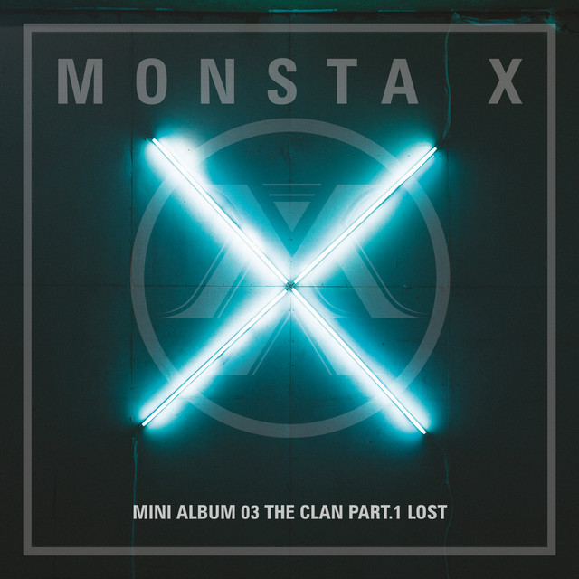

# THE CLAN pt.1 <LOST>

- 아티스트: 몬스타엑스
- 발매일: 2016-05-18
- 별점: ★★☆ 2.8
- 기록일: 2026-02-26
- repov 인덱스: 551

---

이 앨범은 활동곡만 빼면 명반이다. 그런데 활동곡이 사상 역대로 후지다는게 문제지.

1. EX GIRL 4.0
이제는 거의 로스트 테크놀로지 같은 장르다. 난 이 들척지근한 한국형 알앤빈지 힙합인지를 그닥 좋아해본 적 없는데, 그래도 듣기 편안하다는 건 인정한다.

2. 걸어(ALL IN) 0.5
그래... 몬스타엑스 앨범 전체를 듣겠다는 건 언젠가 이 노래를 피하지 않고 마주하겠다는 뜻이다. 장난 아니지? 목숨 걸어.

3. Stuck - 네게만 집착해 0.5
아 씨발 이것도 있었네

4. 백설탕 3.5
몬스타엑스가 여미새 그룹인 이유는 드라마라마가 타이틀이어서가 아니라 이런 노래가 수록곡이어서다. 여자 좋아하는 남자는 이런 노래를 만들고 부른다. 알겠나요?

5. 반칙이야 3.0
이딴 노래에 생명을 불어 넣겠다고 기현과 주헌을 쓰는게 반칙이다.

6. Because of U 5.0
레스큐더비트님 지금은 어디서 뭐하시는지 모르겠지만 비트 살려주셔서 감사합니다
