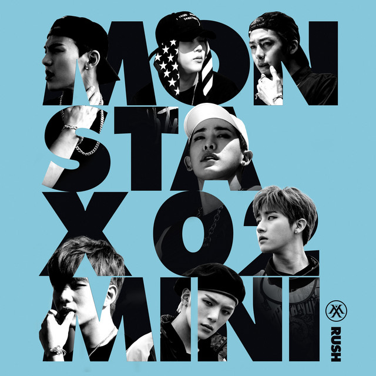

# RUSH

- 아티스트: 몬스타엑스
- 발매일: 2015-09-07
- 별점: ★★★☆ 3.1
- 기록일: 2026-02-26
- repov 인덱스: 552

---

사장님 저는 울면 하나요.

1. 신속히 (RUSH) 3.5
이 노래를 들을 때마다 기리보이의 뒤통수를 한 대 때리고 싶다. 흥겨운 노래와 전설의 댕속히를 만들어준 건 고마운데 주헌이랑 아이엠이 랩 이따위로 쓸 때 왜 안 말렸냐고.

2. HERO 3.0
그리고 옆에 있던 펀치사운드와 라이머도 한 대 맞게 된다. 이 노래를 기점으로 스타쉽은 유기현의 어떤 가능성을 보게 되는데, 끝장나게 마초적인 가사도 끝내주게 낭만적으로 부르는 재능이다. 그 재능을 들킨 죄로 몬스타엑스는 11년 뒤인 지금까지도 여자 너무 좋아해서 돌아버린 노래만 부르게 됐다.

3. PERFECT GIRL 2.5
진짜 만화주인공 같고 현실적이지 않은 외모의 민혁에게 도입부를 맡긴 게 탁월하다. 민혁이 하필 동방신기를 좋아했던 것도 긍정적으로 작용했다. 그 외엔 뭐 신기한 거 없다. 그리고 이 때는 주헌이 연애를 잘 몰랐다.

4. AMEN 2.5
이 노래에 기현, 주헌, 아이엠 외의 다른 멤버는 불필요하다. 꼭 하나 더 껴야한다면 그나마 목소리만은 교회 소년인 셔누 정도? 아예 CCM으로 갔으면 웃기기라도 했겠다.

5. 삐뚤어질래 3.0
아니. 오바 떨지 말고 바로 서라. 비트 좋은 건 알겠는데 우리 그 정도 사이 아니었다. 그리고 매드클라운도 한 대 맞게 오라 그래라.

6. BROKEN HEART 4.0
집어치우라는 가사를 감미롭게 부를 수 있는 건 재능이다. 그런데 스타쉽이 이 노래를 듣고도 몬스타엑스가 뭘 할 수 있는 그룹인지 이해하지 못한 건 불행이다.
