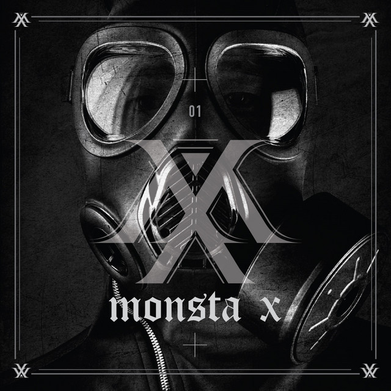

# TRESPASS

- 아티스트: 몬스타엑스
- 발매일: 2015-05-14
- 별점: ★★☆ 2.8
- 기록일: 2026-02-26
- repov 인덱스: 553

---

첫 인상은 중요하다. 그러니 첫 만남부터 범죄를 저지르지는 말도록 하자.

1. 무단침입 (Trespass) 2.0
일단 무단침입은 범죄가 맞다. 내가 기억하기로 이맘때쯤 힙합 그룹을 자처하는 보이그룹들이 이런 노래를 많이 냈는데, 블락비를 제외하고는 아무도 인상적인 음악을 남기지 못했다. 몬스타엑스도 마찬가지다. 다만 주헌이라는 캐릭터는 확실히 남겼다. 고잉세븐틴 명장면도.

2. 출구는 없어 (NO EXIT) 3.0
아마 스타쉽은 처음부터 몬스타엑스 음악의 중심을 주헌으로 박아 놓고 시작했을 것이다. 과연 소유를 가지고도 오직 효린 중심으로 씨스타를 운영한 회사다운 선택이다. 그게 싫다는 말은 아니다. 실제 실력대로 배분한다 하면 이게 맞다. 그러나 누가 들어도 어셔가 생각나는 후렴을 가지고도 파트 분배를 이 따위로 하는 건 너무하지 않나? 셔누가 노래를 할 줄 안다는 사실을 언제부터 까먹었나 했더니 그냥 처음부터 몰랐던 거 같다. 역시 기현은 고군분투할 때 아름답다.

3. One Love 1.5
이건 끈적한 알앤비 곡이고, 당신의 손에는 셔누가 있다. 어떤 선택을 해야겠나? 기현은 그냥 노력하는 거지 알앤비를 이해하는 게 아니다.

4. 솔직히 말할까 3.5
그 시절 감성 알지? 이 노래가 살아남은 이유는 주헌과 기현을 아끼지 않아서다. 거기에 아이엠 한 스푼 정도. 진짜 솔직히 말할까? 귀여운 노래다.

5. 훔쳐 (STEAL YOUR HEART) 2.5
몬스타엑스는 시작부터 섹시한 그룹이었다. 이 심심하고 대충 만든 노래를 여기까지 끌어올릴 수 있는 셔누와 기현에게 박수를 보낸다. 아직 그룹명과 낯 가리고 있던 주헌이 남몰래 발음을 몬스터엑스라고 한 점이 소소한 웃음 포인트다.

6. BLUE MOON 4.0
가끔 주헌의 Push가 어디서 나온 음악인지 궁금해하는 사람들이 있는데, 이 노래를 알고 있는 나는 그가 원래 가지고 있던 악상이라고밖에 대답할 수 없다. 그런데 이 노래를 다시 녹음하라고 하고 싶진 않다. 지금보다 노래들을 못하긴 해도 이 때만 들을 수 있는 감성이 있어서 말이지.

7. 인터스텔라 3.0
그러니까 기현이 얼마나 심란했겠냐고. 3세대 아이돌은 일반적으로 확신의 메인보컬 하나를 박아 놓고 그 위주로 음악을 운영했다. 기현이 자신감을 가질 근거는 충분했단 말이다. 그런데 회사에 들어가니 주헌이 있었던 거다. 이런 피지컬은 지금 힙합씬에도 잘 없다.
