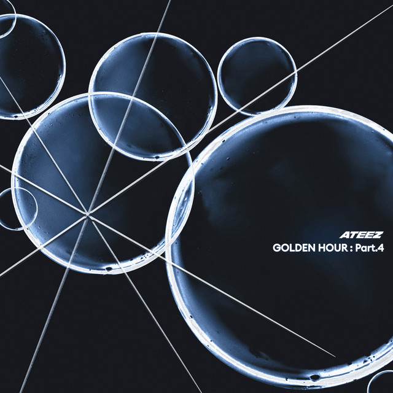

# GOLDEN HOUR : Part.4

- 아티스트: ATEEZ
- 발매일: 2026-02-06
- 별점: ★★★☆ 3.6
- 기록일: 2026-02-25
- repov 인덱스: 555

---

에이티즈는 좋은 길로 가고 있다. 그런 확신을 갖게 해주는 앨범이다.

1. Ghost 3.0
한 때 이런 트랩 비트 위 알앤비를 엑소가 했던 기억이 난다. 알앤비는 난이도가 높은 장르가 맞다.

2. Adrenaline 4.0
최근 나온 이 주제의 곡 가운데 가장 속도감과 파이팅이 좋다. 그렇지만 이게 이 노래의 최대치라는 생각은 들지 않는다. 민기만큼의 피지컬을 갖는 건 힘들겠지만, 그래도 죽기살기로 밀어붙이도록 하자.

3. NASA 4.0
딱히 흠잡을 곳이 없다. 제목이 왜 NASA냐는 의문이 좀 들긴 하는데.

4. On The Road 3.5
팬송은 정말 특출나지 않은 이상 좋은 점수를 주기 망설여진다. 가장 소중한 사람들에게 바친다는 점에서 일단 기본적인 감성을 먹고 들어가기 때문이다. 그래도 이런 팬송은 받아들었을 때 씩 웃음이 나온다.

5. Choose 3.5
그냥 내가 사이키델릭한 밴드 사운드를 좋아한다...
