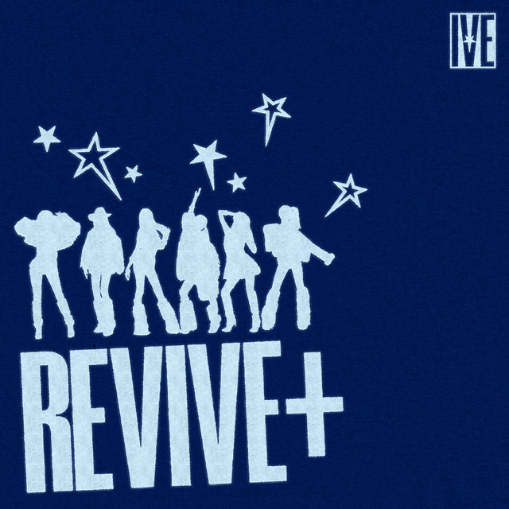

# REVIVE+

- 아티스트: IVE
- 발매일: 2026-02-23
- 별점: ★★☆ 2.2
- 기록일: 2026-02-23
- repov 인덱스: 558

---

성의 없이 만든 앨범을 대중이 성의 있게 들어줘야 하나?

1. BLACKHOLE 2.5
너무 많은 악상이 누더기처럼 얽혀 있다. 그랬다고 아이브에게 이 난장판을 뚫고 엮어낼 실력이 있는 것도 아니다. 차라리 가사를 좀 더 잘 쓰지 그랬나? 그리고 도입부의 무리수는 꼭 지적해야겠다. 이런 식으로 시작하면 그 뒤에 어떤 포부가 있어도 안 듣고 싶어진다.

2. BANG BANG 2.5
한참 욕하고 익숙해질 시간이 있었지만 별로 평가를 번복하고 싶지 않다.

3. 숨바꼭질 (Hush) 2.0
아이브의 음악적 정체성이 촌스러움과 뽕끼가 맞다면 굳이 웅장한 척까지는 안했으면 좋겠다. 현재까지는 Hush라는 단어는 미쓰에이의 입에서 가장 빛났다.

4. 악성코드 (Stuck In Your Head) 3.0
정확히 FLU의 열화판이다. FLU와 달리 이건 어떻게 들어도 활동곡으로 쓸 수 없다는 게 더 절망적이다.

5. Fireworks 1.0
어디서 이런 후진 베이스와 가사를 들고 온 건지? 아니다. 됐다. 해명도 하지 마라. 자체제작도 안하는 아이돌이 한 자기 복제란 점에서 이 노래의 처참한 퀄리티는 윤리적으로 그릇됐다. 심지어 브릿지 멜로디는 몬스타엑스 N the Front 브릿지 전조한 거고.

6. HOT COFFEE 4.0
대체 왜 대중이 이런 노래를 즐길 권리가 없다고 생각하는 건가? 이런 노래를 숨겨두는 건 예의가 아니다. 반드시 Gucci Caliente를 꽉 잡을 것.

7. 8 1.0
이 노래는 장원영에 대한 대중의 기대치 때문에 지나치게 욕을 먹은 감이 있다. 그냥저냥 후진 노래다. 케이팝에 대한 모욕까진 아니다.

8. Odd 4.0
가을이 노래를 잘 하진 않는다. 성량은 너무 작고 특별한 음색을 가지고 있지도 않다. 그래서 이 노래의 최대치가 구현되지 않았다. 하지만 그래서 가을은 책임을 진다. 이 노래의 무대는 꽉 찬 만점이다.

9. Super ICY 1.5
이 그룹에서 일렉트로닉을 해야한다면 이서가 맞다. 하지 말란 소리다.

10. Unreal 4.0
화창하게 안개 낀 캘리포니아에서 조심스럽게 첫사랑의 꿈을 꾸는, 소심한 치어리더 소녀가 떠오른다. 한데 공존할 수 없는 키워드가 이처럼 한데 섞여 간지러운 햇살처럼 빛날 수 있다는 게 이 노래의 "Unreal"한 점이다. 다들 제주도에 절 한 번씩 하자.

11. In Your Heart 3.0
예 최상혁씨 레이의 키치함이 마음에 드셨나보군요.

12. Force 3.0
아 또 엔커밍이야... 여튼 안유진은 추구미를 잘 찾아갔다. 그런데 유진아 리틀 믹스는 네 명이었단다. 혼자서 감당할 수 있는 스케일이 아니다.
