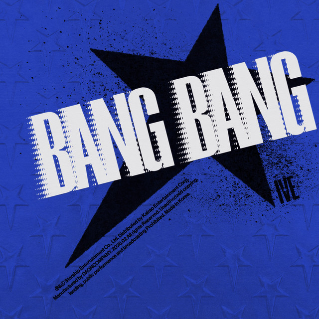

# BANG BANG

- 아티스트: IVE
- 수록: BANG BANG
- 별점: ★★☆ 2.5
- 기록일: 2026-02-10
- repov 인덱스: 561

---

전원 성인이 된 아이브를 기대하지 않은 사람이 있나? 이들이 기어코 하고 말 섹시 컨셉을 손꼽아 기다린 사람이 없겠나? 나의 기대는 또다시 배반당했다.

데뷔곡 『Eleven』에서 정점을 찍은 후 지금까지 아이브의 음악은 꾸준히 하향 곡선을 그렸지만 이번만큼은 반등해줄 줄 알았다. 그야 아이브는 씨스타와 몬스타엑스를 키워낸 스타쉽의 최고 아웃풋이니까. 그런데 에이스들 키키 키우라고 쫓아내고, 캐시카우 돈 들어오는 자리에 엉덩이 깔고 앉은 높은 분들아. 대체 아이브를 어디까지 끌어내릴 작정인가?

일단 노래의 세계관부터 이해가 안된다. 이 장르가 그래서 사이버펑크인가 서부극인가? 『가디언즈 오브 갤럭시』 스타일의 스페이스 오페라라고 하면 정말 죽여버리겠다. 일렉트로닉을 하고 싶으면 묵직한 쇠를 떨어뜨리고, 웨스턴을 하고 싶으면 흙먼지를 뿌려야할 거 아닌가. 쇳가루가 흩날리면 그건 그냥 황사다. 이 노래는 기후재앙이다. 이딴 노래를 만들어낸 프로듀서진에게 묻는다. 레이와 가을에게 멱살이 잡혀 끌려가는 것이 조금도 부끄럽지 않나?

뮤비조차 시대착오적이다. 언제적 쿠엔틴 타란티노인지도 모르겠다. 그 양반은 여성과 아시안을 죽도록 혐오하는 미국 영화계가 키워낸 포르노 감독이다. 『원스 어폰 어 타임 인... 할리우드』가 그 사실을 명징히 증명한다. 멋진 거 이미 『키치』로 충분히 시도해보지 않았나? 그 놈의 아무 맥락 없는 총 좀 집어넣으면 안되나?

브라운아이드걸스의 『킬 빌』은 2013년 노래다. 이 노래는 2026년작이다. 이 노래의 존재 자체가 케이팝 퇴보의 증거다.

이 노래를 듣고 스피닝 세션에서 앞다퉈 사용할 거라느니, 레이와 가을은 국힙 원탑이라느니, 이서의 댄스 파트가 킬링파트라느니 하는 다이브들의 영업글을 봤다. 전부 동의한다.  모두 맞는 말이다. 레이와 가을은 작두를 탔고 이서는 봉인이 해제됐다. 장원영, 안유진, 리즈는 늘 그랬듯 아이브의 가장 큰 자산들이다. 그리고 그게 끝이다. 스피닝 강사가 좋아하겠다는 말도 솔직히 조롱에 가깝다. 팬이니까 어떻게든 포장하는 것 뿐이다. 다이브는 데뷔한 그 순간부터 아이브의 가장 든든한 지원군이 틀림 없다. 100가지 요소 중에 99가지가 구린데 어떻게든 1가지의 반박할 수 없이 좋은 점을 캐내어 영업해주니까.

잔뜩 피어난 이서에게 미안해서라도, 스타쉽은 앨범 퀄리티를 제고해야할 것이다. 솔직히 그래줄 거란 믿음은 없지만.
