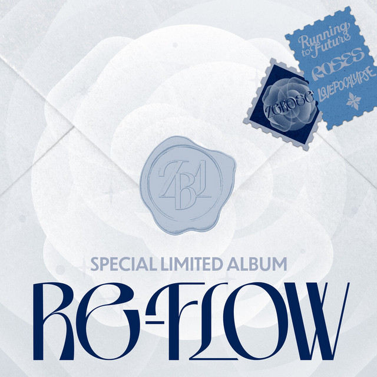

# RE-FLOW

- 아티스트: ZEROBASEONE
- 발매일: 2026-02-02
- 별점: ★★★☆ 3.7
- 기록일: 2026-02-02
- repov 인덱스: 563

---

섭섭하지만 아쉽지는 않을 안녕.

1. Running to Future 4.0
아름다운 마지막은 배려일까 가해일까. 그래도 좋았다고 말하며 끝낼 수 있다는 건 팬에게 축복이다. 그렇게 믿고 싶게 만드는 노래다. 김태래와 석매튜는 지금까지도 그랬지만 앞으로 더 기대되는 목소리다.

2. ROSES 4.0
김태래 칭찬을 안할 수 없는 노래다. 이 여행이 끝나도 그가 속하게 될 그룹의 노래는 계속 듣겠다.

3. LOVEPOCALYPSE 3.0
거창한 제목과 마지막 타이틀이라는 상징성에 비해 지나치게 안이한 곡 진행이 아닌가 싶은데. 올리팝과 가브리엘 브란데스 조합은 너무 평탄하지 않나? 파티 락이 망한 이유는 그냥 크래비티가 노래를 못해서라고 치더라도.
