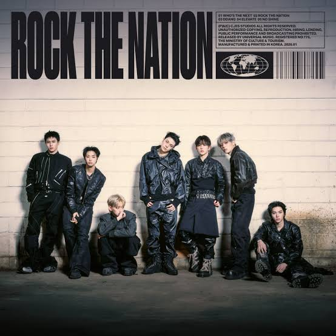

# ROCK THE NATION

- 아티스트: WHIB
- 수록: 2026
- 별점: ★★★☆ 3.3
- 기록일: 2026-01-29
- repov 인덱스: 564

---

다들 노력하는데 미안한 말이지만, 세상은 이 정도로 흔들리지 않는다.

1. WHO'S THE NEXT 3.0
체급은 된다. 적어도 대문자를 짊어질 수 있을 정도다.

2. ROCK THE NATION 3.0
노래를 케이팝 시장에 내놓았을 때 무슨 일이 일어날 지 상상해보라. 이 정도의 노래로는 나라를 흔들 수 없다. 3옥타브를 지를 수 있는 메인보컬이 있다는 건 반갑지만, 좀 더 잘 쓸 수 있다. 

3. DDANG 3.0
너무 생각이 많다. 이 노래의 목적이 뭔가? 멤버들이 노래를 잘한다는 이유로 들어줄 수 있는 건 54초까지고, 그 뒤로는 당황스럽다. 믹스팝이 그렇게 쉬운 장르였다면 엔믹스가 3년을 헤맸겠나? 처음의 악상으로 끝까지 갈 수 없다는 건 맞지만, 최소한 납득은 가게 만들어라.

4. ELEVATE 3.5
내가 이 그룹의 팬이었다면 앨범에 이 트랙이 있다는 사실에 감사했을 거다. 최소한의 퀄리티 증명은 할 수 있는 노래다.

5. NO SHINE 4.0
좋다. 한국풍을 시도하는 그룹 중에서 독특하다고 말할 수 있는 사운드이다. 한 가지만 지적하자면, 메인보컬이 고음 좀 친다고 해서 포켓몬 기술 쓰듯 갑자기 내놓는 건 촌스러운 일이다.
