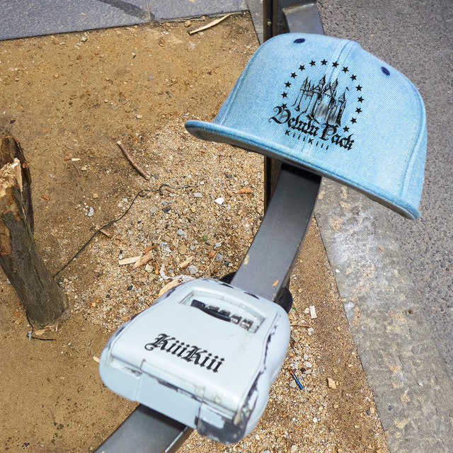

# Delulu Pack

- 아티스트: KiiiKiii
- 발매일: 2026-01-26
- 별점: ★★★☆ 3.7
- 기록일: 2026-01-26
- repov 인덱스: 570

---

키키가 뭐하자는 그룹인지 정해지지 않은 상태에서 일단 좋은 곡만 끌어 모은 결과.

1. Delulu 3.0
재미가 있거나 비전이 있는 사운드는 아니다.

2. 404 (New Era) 4.5
잘 만든 UK 개러지 하우스. 미안하지만 그 외에는 별로 뭐라 더할 말이 떠오르진 않는다. 키야의 기세는 독보적이다. 그나저나 뮤직비디오 말인데, 레퍼런스는 죄가 아니라지만 좀 적당히 하지.

3. UNDERDOGS 3.5
당황스럽다. 확실히 스타쉽 아이돌은 저항을 이야기할 때 가장 잘 어울리긴 하는데, 이젠 그룹의 컨셉을 잘 모르겠다. 그래서 뭘 하고 싶은 거지?

4. MUNGNYANG 4.0
그러니까 정말 뭘 하고 싶은 거냐고. 어쨌든 최근 힙합한다고 나온 아이돌 노래 중에서는 사운드가 제일 신선하긴 하다.

5. Dizzy 4.0
키키의 강점은 어쨌든 멤버들의 목소리가 좋다는 거다. 음악에 대한 이해도도 높고. 그러니까 이런 노래도 할 수 있는 거다. 난 이제 슬슬 스타쉽이 자기들이 뭘 잘하는지 좀 깨달았으면 좋겠다. 남이 하던 거 그만 좀 주워 먹고.

6. To Me From Me 3.0
정말 웃긴데, 앨범 전체로 들었을 때 이 노래가 키키와 가장 안 어울린다. 타블로는 언제나 무너짐에 관한 노래를 가장 잘 만들지. 그런데 스타쉽은 이런 축축한 사람들 안 키우더라고.
