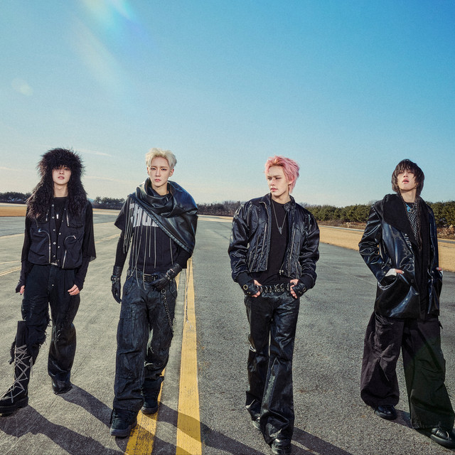

# Amplify My Way

- 아티스트: AxMxP
- 발매일: 2026-01-21
- 별점: ★★★★ 4.0
- 기록일: 2026-01-22
- repov 인덱스: 571

---

JYP가 아무리 발버둥쳐도 역시 정통 밴드 명가는 FNC다.

1. PASS 3.5
일단 에프티아일랜드와 린킨파크에게 감사하다고 한 마디 해라. 그룹 소개에 힙합도 할 줄 안다고 쓴 걸 봤다. 그래서 약간의 마이크 시노다와 일본 쪽 하드코어 락을 이어 붙인 티가 난다. 지금은 기타가 약간 정제된 느낌인데 좀 더 라이브를 강조하는게 좋지 않았나? 거기까진 취향 차이라고 할 수도 있겠지만, 기왕 날뛸 거면 확실하게 날뛰어줬으면 한다.

2. Too Much 4.0
오케이. 머리 풀고 흔들어줄 의향이 생긴다. 락페스티벌에서 보자.

3. Punch-Drunk 4.0
당장 제일 가까운 락페스티벌이 언제더라? 이런 노래는 처음 보는 사람들과 둥글게 어깨동무하고 잔디 밟아가며 들어야 예의다.

4. 너의 멜로디가 됐어 (I Melody You) 3.0
일단 제목 때문에 반 점 까겠다. 늙은이는 아이서울유에 별로 좋지 않은 감정이 있답니다. 그래도 계속 한 노래에 여러 박자를 시도하는 점은 높이 산다. 덕분에 지루하지 않다.

5. 그리고 며칠 후 (Thereafter) 3.5
좋은 노래긴 한데, 이 노래가 3,4번 트랙과 따로 존재해야하는 이유는 뭔가?

6. 가끔씩 욕해 (Bittersweet) 5.0
그냥 내가 이런 노래를 좋아해. 그런데 가사 말이야, 지금이 대체 몇 년도야?

7. 너의 평소에 (Be Yours) 5.0
6번 트랙이 마음에 안 들었던 분들은 이 노래 들으시면 되겠어요. 역시 사람은 좀 찌질해야 예술을 잘하나보다.
