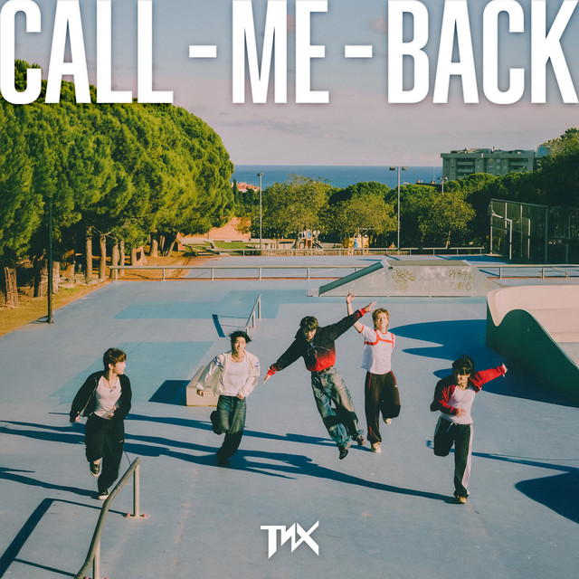

# CALL ME BACK

- 아티스트: TNX
- 발매일: 2026-01-22
- 별점: ★★★★☆ 4.3
- 기록일: 2026-01-22
- repov 인덱스: 572

---

저 청년들이 어딜 향해 달려오는지 물어볼 필요 없다. 청춘은 설명하지 않아도 느껴지는 거니까.

1. CALL ME BACK 4.0
오랜만에 몸을 깨우는 목소리를 듣는다. 재능이란 참 이렇게도 압도적이다. 튠이 이런 음색까지 만들어주지 못하더라고. 별점 반 개는 아무리 그래도 지나친 가사의 촌티 때문에 깎는다.

2. 그러니까 내 말은 (Love Letter) 4.5
사랑이 쉬웠던 역사는 인류에게 없다. 그러니 모든 고민을 내려놓고 그저 좋아한다는 말에는 언제나 울림이 있다.
