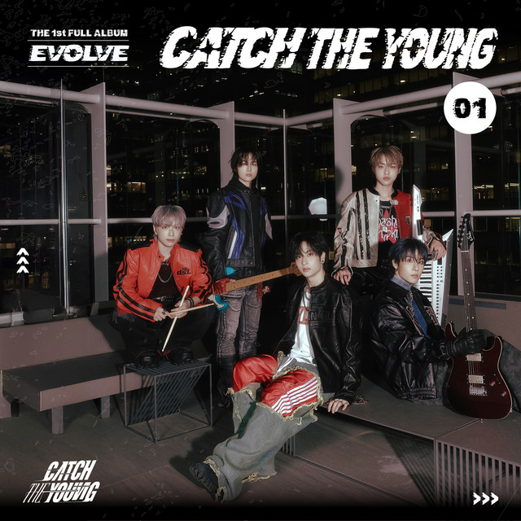

# EVOLVE

- 아티스트: Catch The Young
- 발매일: 2026-01-19
- 별점: ★★★☆ 3.1
- 기록일: 2026-01-20
- repov 인덱스: 574

---

보컬은 세션의 열정에 잡아 먹히기 전에 진화하는 게 좋을 것이다

1. Evolution: Prelude -

2. Amplify 1.5
혹시 락이 우습나? 프론트맨이 파이팅을 안 보여주는데 이게 무슨 밴드고 이게 무슨 락인가. 이빨 꽉 깨물고 덤벼라.

3. Stay In The Dream 3.0
훨씬 흥미롭다. 전주곡이 있다는 것에서 대충 예상했지만 기타가 좀 치는 놈이다. 본인이 잘한다는 자각도 있다. 그런데 정말로 보컬 잘못 뽑았다. 목소리는 밴드의 얼굴이고 메시지의 방향성이다. 이게 최선이었나?

4. 찬란히 빛나줘(Sail) 3.0
키보드도 최소한의 공감각을 아는 사람이다. 밴드가 전체적으로 이 노래를 잘 이해하고 있다. 다시 묻겠는데 여기 보컬 이게 최선인가? 길 가던 남자애 붙잡아서 실용음악학원에 6개월 가둬 놓으면 이 정도 음정은 맞춘다. 여기 보컬에게 필요한 건 음악이 아니다. 폭포다. 거기서 성대 수련 좀 해라.

5. 더 좋은 날(Better Days) 1.5
모름지기 락은 한 곡 한곡이 주머니를 뚫고 나오는 송곳처럼 선명한 주제의식을 들려줘야 한다. 밴드가 이런 안이한 앨범 구성을 한 것 자체가 나쁘다.

6. 28 Hours 4.0
이게 바로 그 낭중지추다. 레이지하고 나약하며 로맨틱한 자신을 받아들여도 괜찮다. 락은 다른 누군가가 아니라 자기 자신의 음악이어야 하니까.

7. From Now On 3.5
5번 트랙까지는 없는 노래로 치자. 세션맨들 야망 따라가려면 보컬 모가지가 찢어지겠지만, 어쩌겠는가. 한 번 찢어라. 원래 락은 다 성대결절 걸려가며 하는 거다.

8. I'm Already In Love With You 3.5
키보드가 보통 성깔하는 놈이 아닌가 보지? 베이스도 재즈 사운드에 더 익숙한 게 들린다. 

9. Addicted 3.5
지금까지 듣기에, 기타&드럼 연합과 베이스&키보드 연합 사이 약간의 의견 차이가 있다. 굉장히 좋으니까 계속 그렇게 박터지게 싸워라. 원래 불화는 락밴드의 소양이다. 박터뜨리는 김에 보컬 목도 좀 터뜨리고.

10. Hurricane 4.0
함께한지 5년 되는 밴드가 10번째 트랙이 되어서야 합이 맞으면 어쩌자는 건가? 참나.

11. Alive 3.5
기타 분 알겠어요 알겠으니까 진정은 하지 마시고 님이라도 힘내세요

12. Reperio 3.5
보컬이 영어를 못하면 시키지 마라. 아니면 스피킹 학원을 끊어주든가.

13. 지금, 내 앞에 서 있는 네게(To You, Standing Before Me) 2.5
그래 한국 밴드맨 중에 넬 안 들은 사람이 어디 있겠어. 그런데 모든 밴드가 김종완을 가질 수는 없다. 보통 거기서 비극이 시작된다.

14. The Young Wave (2026 Remix) 3.5
기타랑 키보드가 주먹 쥐고 싸우고 있으니 다들 오셔서 구경 한 번 하고 가세요
