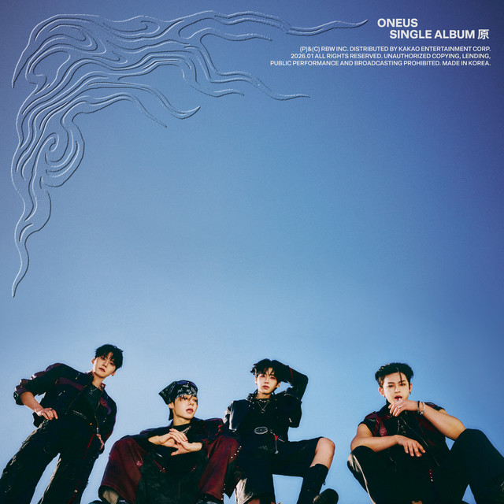

# 原

- 아티스트: 원어스
- 발매일: 2026-01-20
- 별점: ★★ 2.0
- 기록일: 2026-01-20
- repov 인덱스: 575

---

그냥 시원하게 놀고 가지, 재시작은 무슨. 노래하는데 무슨 생각이 그렇게 많은지.

1. Grenade 1.5
다들 군대가기 전 아닌가? 갔다 와서 얘기하자.

2. STOP & MOVE 2.5
노래를 할 줄은 아는 그룹이다. 실제로 뒤로 갈수록 조금씩 신나기 시작한다. 그런데도 왜 이렇게 뒤끝이 처량한지 모르겠다.

3. When you're close to me 2.0
알앤비 못하겠으면 하지 마라.
