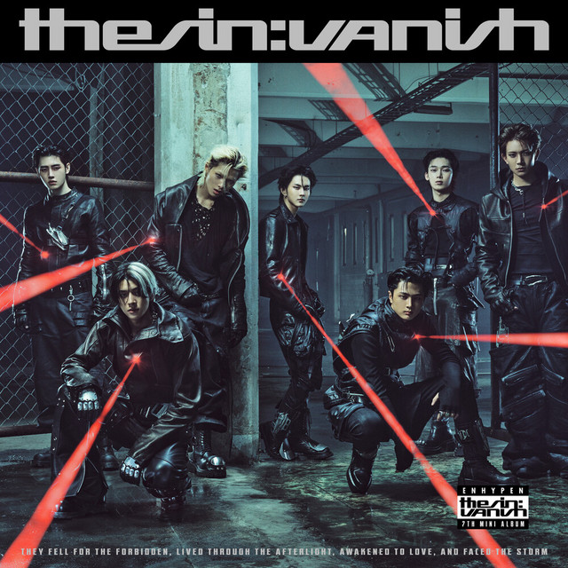

# THE SIN : VANISH

- 아티스트: ENHYPEN
- 발매일: 2026-01-16
- 별점: ★★☆ 2.8
- 기록일: 2026-01-20
- repov 인덱스: 576

---

멋진 콘셉트 앨범일 수 있었는데, 엔하이픈에겐 이걸 감당할 능력이 없다.

1. 사건의 발단 3.0
이야기의 힘이 강력하다. 그렇지만 섹시한 트랙에 동물의 왕국 나레이션은 미스 초이스이긴 하다.

2. No Way Back 3.0
엔하이픈이 어떻게 그들의 세계관으로 무수한 해외팬을 빠뜨렸는지 알겠다. 이렇게 묵직한 알앤비 곡을 당당하게 가져오는 그룹이 요즘 많지 않다. 그런데 역시나 소화력은 문제다.

3. 도망자들 3.5
1번 트랙에서도 느꼈지만 나레이터의 톤이 영 곡에 안 붙는다. 사운드의 배치 자체는 탁월하다.

4. Knife 3.0
나는 이 세계관이 무척 마음에 들었기 때문에, 이 곡의 선택을 안일하다 비판할 수밖에 없다. 우리 지금 뱀파이어의 탈출 얘기하고 있었지? 그럼 트랩 비트의 힙합을 써도 파이프 오르간 정도의 고딕적인 스케일은 가져왔어야 한다. 무엇보다 엔하이픈이 노래를 못 살린다.

5. Stealer 2.5
정말 이렇게 가볍게 부를 작정인가? 엔하이픈의 실력은 일찍이 Bite Me에서도 대충 느끼긴 했었다. 노래를 이해하고 부르는 사람이 희승 하나뿐이라는 감상이 아직까지 이어지는 건 문제다. 단순히 스킬만 없는게 아니라, 노래를 대하는 성의 자체가 없다.

6. 우리가 찾던 목소리 2.5
지금 내가 느끼는 어색함이 디렉션의 문제인지 매직키드 마수리의 데자뷰인지 아리까리하다. 정확한 판가름을 위해선 백종원이라도 불러와야할 판이다. 어쨌든 나는 보류.

7. 목격자 2.0
거 나레이터 좀 연기력 되는 사람으로 뽑으면 안되나? 아니면 최소한 발성이라도.

8. Big Girls Don't Cry 2.5
SM이 플랫한 보컬을 여러 겹으로 쌓은 크레이프라면, 빌리프렙은 그냥 사운드에 뜻이 없는 호박당이다. 그 맛이 얄팍하기 이를 데 없다. 뭘 느껴야 하는지도 모르겠다. 이걸 부르고 있는 자신들도 모른다. 노래가 너무 아깝다.

9. Lost Island 3.0
이런 주제의 앨범이라면 당연히 들어 있어야 하는 노래다. 그런데 이렇게 영혼 없이 부를 거면 나는 당신들과 같은 무인도에 갇히고 싶지 않다. 

10. Sleep Tight 3.0
대체 언제까지 노래가 멱살 잡고 끌고가야 하나? 이제 적은 나이도 아니지 않나? 좀 주체성을 가지고 곡을 이해하려는 시도 정도는 해보는게 어떠한가? 세상에는 당신들보다 적은 자본과 기회를 가지고도 최선을 다하는 아이돌이 얼마든지 있다.

11. 사건의 너머 2.5
아깝다 아까워
