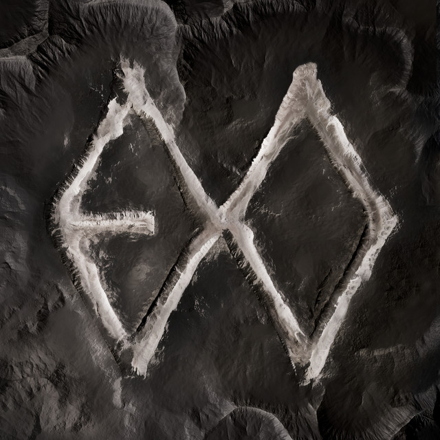

# REVERXE - The 8th Album

- 아티스트: EXO
- 발매일: 2026-01-19
- 별점: ★★☆ 2.8
- 기록일: 2026-01-19
- repov 인덱스: 577

---

그 시절의 추억이 잘 살아있다. 내가 엑소를 그렇게까지 싫어한 그 이유까지 고스란히.

1. Crown 3.0
추억보정이라고 해도 좋다. 이 거창한 화음이 많이 그리웠다. 역시 쓸 데 없는 사족은 쳐내는 게 좋다.

2. Back It Up 2.5
헛웃음이 나올 정도로 개운하다. 그래서 엔시티보다 나은 점이 뭐냐고 묻는다면 디오 정도?

3. Crazy 3.5
엑소 노래라고 한다면 이것보다 좀 더 짙지 않았나? 그래도 이 나이에 이 정도 파이팅이 나오는 건 칭찬할만한 일이다. 엑소가 노래를 못하는 것과 별개로 보이넥스트도어는 이걸 듣고 반성 좀 해야 한다. 찬열도 들을만한 노래가 이 세상에 존재할 수 있다는 게 신기하긴 하다.

4. Suffocate 2.0
좋은 노래가 엑소에게 잘못 가는 것도 고증인가? 애초에 이런 질감이면 안된다. 가성이 아름다운 테너가 없다는 단점은 이렇게 발현된다. 좀 더 날카롭고 산뜻하게 제련해줄 수 있는 사람에게 가는 편이 노래에겐 더 좋았을 것이다.

5. Moonlight Shadows 3.0
이런 노래를 잘하는 사람이 디오 밖에 없어서 섹시해야할 노래가 대충 둔중하기만한 것까지 예전의 엑소 그대로라 웃음만 나온다. 비웃는 건 아니다. 지금까지 했는데도 안되는 걸 뭐 어쩌겠는가. 노래 자체는 엄청난 명곡이다.

6. Back Pocket 3.5
정말 노래 듣는 귀 하나는 인정한다. 그렇게 엑소가 망쳐놓은 명곡 리스트에 이 노래도 추가된다. Cruel 발음과 구 SM 맛의 한참 잘못된 랩이 헛웃음 포인트다. 이 노래는 샤이니가 좀 더 생각난다. 샤이니가 더 잘했을 거란 뜻이다.

7. Touch & Go 2.5
"제어가 안돼!"
이건 진짜 웃음밖에 안 나온다.

8. Flatline 2.5
사이키델릭한 베이스와 멜랑콜리한 멜로디라인이 좋은 밴드 음악이다. 이제 이들의 목소리만으로는 슬슬 부대끼니까 려욱 같은 보컬 하나 끼워주면 안되나?

9. I'm Home 3.0
아이고 집에 오셨구나 결국
