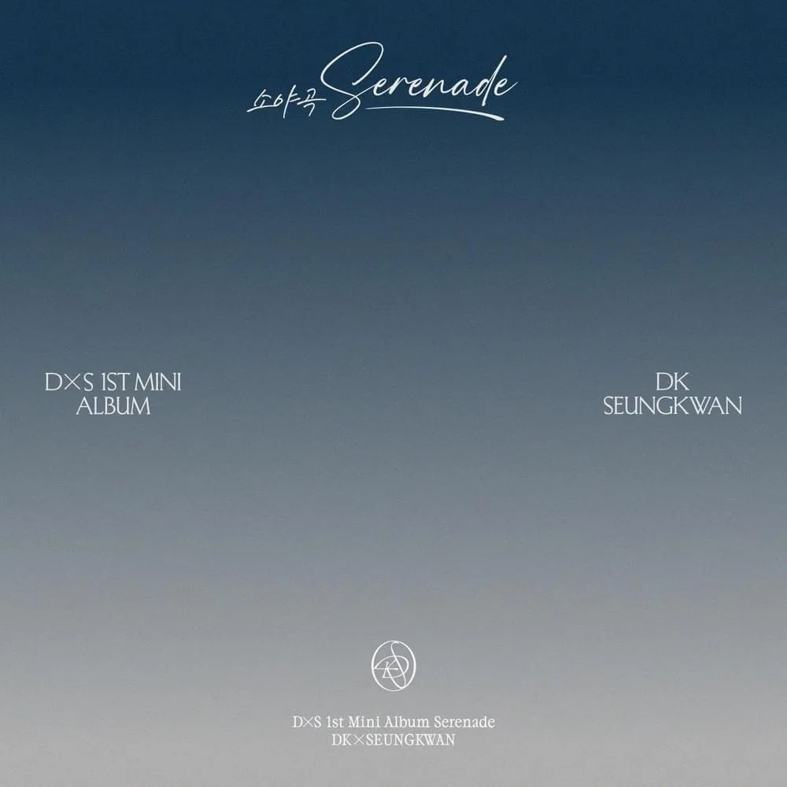

# 소야곡

- 아티스트: 도겸X승관
- 수록: 2026
- 별점: ★★★ 3.0
- 기록일: 2026-01-12
- repov 인덱스: 586

---

소야곡은 모두가 잠든 저녁, 연인의 창가 앞에서 부르는 노래다. 부를 수 있을지 잘 생각해보길 바란다.

1. Rockstar 2.0
어쩌면 내가 도겸을 너무 과대평가한 걸까?

2. Blue 2.5
반주가 과하다. 이럴 필요 없다.

3. Guilty Pleasure 1.5
레이백도 못 타는 사람들 데리고 섹시한 노래 할 수 있다는 착각은 누가 자꾸 하는 건가?

4. Slience 3.0
드디어 앨범 제목에 걸맞은 노래다. 다만 욕심은 내려놓길.

5. Dream Serenade 5.0
승관이 타고난 보컬이라고 말하지 않겠다. 하지만 그는 자신이 무슨 말을 하는지 가슴으로 알고 있다. 우리는 이런 사람을 타고난 예술가라고 부른다.

6. Prelude of Love 4.0
서곡은 앞에 와야 한다. 이 노래의 위치와 이것이 타이틀이 아니라는 사실 말고는 아무 불만 없다.
