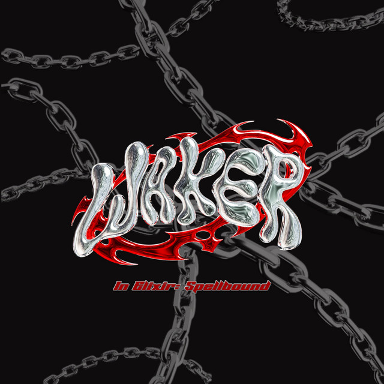

# In Elixir: Spellbound

- 아티스트: WAKER
- 발매일: 2026-01-08
- 별점: ★★★☆ 3.3
- 기록일: 2026-01-08
- repov 인덱스: 588

---

넘치는 성의에 비해 환경이 너무 빈한하다. 부디 이들의 소속사에 돈이 솟아나길 빈다.

1. 11시 59분 3.0
곡 자체가 특별히 신선하다거나 만듦새가 좋다고는 할 수 없다. 솔직히 말하자면 너무 많이 들은 내용이다. 그런데 이 그룹에는 노래를 할 줄 아는 멤버가 있다. 고막 정도에는 충분히 달라 붙는다.

2. LiKE THAT 3.0
소속사가 돈이 없지? 작곡 프로그램 기본만 겨우 벗어난 소스로는 다 구현할 수 없는 노래다. 케이팝이 비싼 산업이라는 걸 증명하는 노래를 들을 때마다 참 기분이 씁쓸하다.

3. Lucid Dream 3.5
요즘 남자아이돌 사이에서는 씨가 마른, 좋은 바리톤이 있다. 그리고 한 명 정도를 제외하고는 음색이 좋다. 어떤 멤버들인지 알고 싶다. 이딴 덜그덕대는 사운드로도 사람을 궁금하게 만드는 건 재능이다.

4. Revive 3.0
야망은 인정한다. 그런데 혹시 군비경쟁이라는 말을 알고 있나?

5. 10 outta 10 3.0
정말 안타까워 미치겠다. 이 노래는 어느 정도 규모 있는 소속사라면 타이틀로 원할 수 있을 정도로 좋은 노래다. 멤버들의 보컬 능력도 좋다. 그런데 대체 이 끔찍한 악기 소리는 뭐란 말이냐.

6. 새벽별 2.5
뭔 노래방 반주 피아노를 쓰고 있네

7. Feeling 3.0
이번엔 노래방 반주 기타다. 아니 좋은 노래야 잘 만들었어 이런 위트 있고 섹시한 노래가 있는 건 정말 좋은 기획이라고. 아니 하 진짜로... 진짜로 제발 대표님 신용 없으십니까?

8. Sugar Crush 3.0
4,5세대 남자아이돌이 이 정도의 노래를 이 정도로만 부를 수 있었으면 대중성 염불 안 외워도 됐을 거다. 그들은 자기가 망쳐버린 재화의 가능성을 이해하기나 할까? 오늘도 분노가 깊어만 간다.

9. Drop Out 3.0
여기서 오직 멤버들만 소리를 만드는 방법을 알고 있단 걸 증명당할 때마다 가슴이 우두둑 무너지는 기분이다.

10. Dreaming Talk: DAY 3 -
스킷에는 점수를 매기지 않는다. 이 그룹이 정말 잘 되어서 이 스킷이 아름다운 흑역사로 남길 바란다. 그런데 혹시 팬덤 이름이 슬리퍼야?
