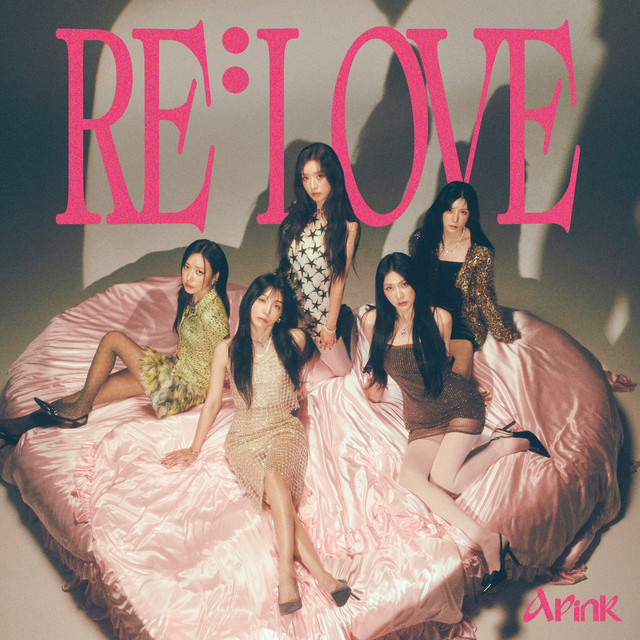

# RE : LOVE

- 아티스트: Apink
- 발매일: 2026-01-05
- 별점: ★★★☆ 3.8
- 기록일: 2026-01-07
- repov 인덱스: 592

---

에이핑크가 있다는 건 참 좋은 거야 그렇지

1. Love Me More 5.0
시간이 흘러도 난 여전히 에이핑크야

2. Fizzy Soda 2.5
샘플링 힙합이 요즘 애들 노래라고 말하는 게 좀 웃기긴 하지만, 에이핑크가 요즘 애들 노래를 할 필요가 있나 싶다. 이미 케이팝에서 에이핑크의 자리는 대체할 수 없는데.

3. Birthday Cake 5.0
3세대 걸그룹 중 레드벨벳 말고 2000년대 R&B를 해야하는 그룹이 있냐고 물으신다면, 당연히 에이핑크.

4. Sunshine 3.5
이런 노래는 벅찬듯이 불러야하기 때문에, 3옥타브 이내의 음역이 전혀 벅차지 않은 정은지에게 어울리는 곡은 아니라고 생각한다. 보미는 또 너무 얇고. 그러니 이 노래는 김남주다.

5. 손을 잡아줘 3.0
정은지가 발라드를 한다. 가만히 앉아서 듣도록 하자.
