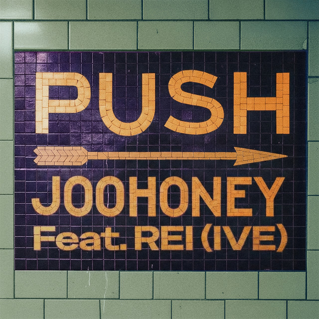

# 光 (INSANITY)

- 아티스트: 주헌
- 발매일: 2026-01-05
- 별점: ★★★☆ 3.4
- 기록일: 2026-01-05
- repov 인덱스: 595

---

호시야 지금까지 호랑이 행세 하느라 수고했고 형이 재밌는 거 들려줄게

1. Gwang 1.5
주헌은 자신의 독보적인 피지컬을 독창성으로 오해하는 경우가 있다. 듣기 좋은 노래냐고 묻는다면 대답은 당연히 "Yes"지만, 이 세상에 필요한 노래였냐고? 글쎄.

2. Fear 2.0
하드코어한 사운드에 비해 메시지는 레임하다. 주헌이 완전히 프로듀서고 이 곡이 사운드 클라우드에 올라왔다면 박수갈채를 쳤겠지만, 그는 래퍼이지 않나? 재밌는 랩을 써야지.

3. STING 3.5
무하마드 알리 인터뷰로 시작되는 사운드가 갑자기 비욘세의 『Beyoncé』 앨범을 떠올리게 만든다. 독보적으로 좋은 노래라고 할 수 없으나, 주헌의 피지컬로 내뱉는 "I'm gonna float like a butterfly, sting like a bee!"를 거부하는 게 쉬운 일은 아니다.

4. Push ) 4.5
사운드의 구현에서 주헌의 탁월함을 논하는 건 이제 지겨울 정도다. 어떠한 사운드도 낭비되지 않는 노래를 듣는 건 항상 청각적 쾌감을 일으킨다. 완벽에 가깝게 만들어진 곡. 레이라는 악기의 가장 아름다운 소리는 이 노래에 담겨 있다. 서둘러 연말에 공개한 이유를 알겠다.

5. Bite 4.0
덥썩 목덜미를 물린 순간, 정글이니 메탈이니 하는 것들은 전부 우습게 느껴진다. 여기는 장르도 없다. 흑표범이 그르렁거리는 밀림 뿐이다.

6. Touch the Sky 5.0
퇴근길 만원 지하철에서 일어섰다. 거부할 수 있는 노래가 아니다.

7. NO BRAIN NO PAIN -
노브레인이 피처링으로 참여하지 않은 상태의 이 노래는 평가하지 않겠다. 어서 노브레인을 불러와라.
