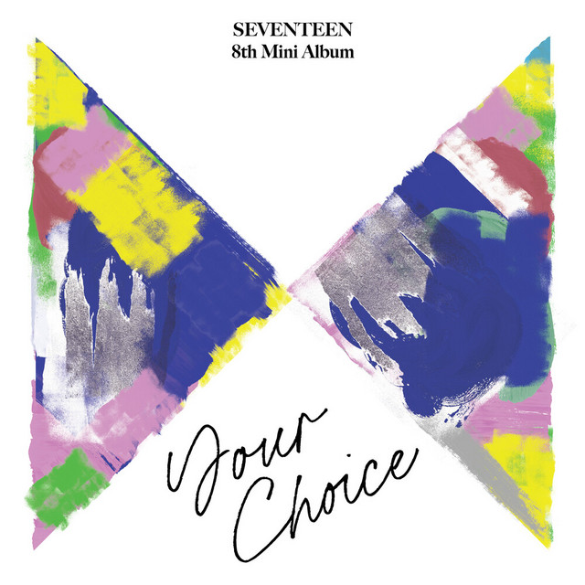

# SEVENTEEN 8th Mini Album 'Your Choice'

- 아티스트: 세븐틴
- 발매일: 2021-06-18
- 별점: ★★★☆ 3.8
- 기록일: 2025-11-26
- repov 인덱스: 616

---

프로듀서라면 응당 음악을 통해 세상을 그려낼 줄 알아야 한다. 바로 이렇게.

1. Heaven's Cloud 3.5
버논의 음색과 승관의 감성은 세븐틴의 복이다. 거기에 우지의 장기인 탑라인이 아낌없이 펼쳐지니 좋은 노래라 말하지 않을 이유가 없다. 다만 준을 가성 영역에 배치하는 건 좀 그만둬줬으면 한다.

2. Ready to Love 4.0
조슈아와 도겸의 목소리로 사랑 노래를 연다는 건 어떤 각오를 했다는 뜻이다. 우지가 천재 프로듀서인 이유는 단순히 멜로디만 잘 만들어서가 아니다. "처음 느낀 심장의 속도가 이리 빠른지 몰랐어", "세상의 반대로 run away" 같은 가사를 써낼 수 있기 때문이다. 그에게는 마이너리티의 감성을 아름답게 그려내는 재주가 있고, 그래서 사랑을 하는 모든 형태의 사람들에게 어필한다.

3. Anyone 5.0
사실 작곡은 아무나 할 수 있다. 아무나 할 수 없는 건 베이스와 기타만으로 F1머신이 몰아치는 서킷을 건설하는 일이다. 그 안을 채우는 관중의 흥분과 땀방울, 그리고 팽팽항 긴장감까지.

4. GAM3 BO1 4.5
원우를 향한 우지의 지극한 사랑이 느껴지는 트랙이다.  그러나 이 노래의 히어로는 버논이다. 버논의 음악적 능력치는 항상 나를 놀랍게 만들지만, 이 노래에서 특히 뛰어나다. 훗날 그가 Black Eye나 Shining Star에서 보여줄 너드 페르소나가 이미 이 때부터 존재했다.

5. Wave 3.0
특별히 독특하거나 예상을 뛰어넘는 진행이 없으므로, 노래 자체에 큰 점수를 줄 수는 없다. 다만 절개된 민소매를 입고 이 노래에 맞춰 등장하는 준의 존재는 역사에 남길 만 하다.

6. 같은 꿈, 같은 맘, 같은 밤 2.5
해명하겠다. 이 노래는 좋은 노래다. 가창자가 브루노 마스였다면 역사에 남길 정도로 아름답다. 다만 세븐틴 보컬팀에 R&B를 할 수 있는 사람이 없다. 그것이 문제의 전부이다.
