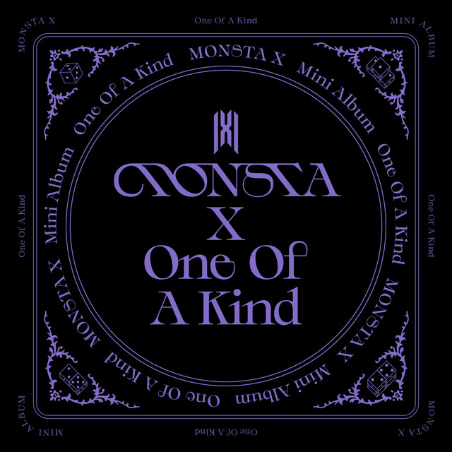

# One Of A Kind

- 아티스트: 몬스타엑스
- 발매일: 2021-06-01
- 별점: ★★★☆ 3.9
- 기록일: 2025-11-25
- repov 인덱스: 617

---

남성 그룹이 할 수 있는 가장 세련된 섹시함

1. GAMBLER 3.5
이 노래는 현 시점에서 마이클 잭슨의 유산에 가장 근접한 노래다. 최소한 사운드 면에서 그렇다. MJ를 존경한다는 아이돌은 많지만 그 휘광에 닿은 아티스트는 많지 않다. 그런데 주헌이 뒤로 갈수록 걷잡을 수 없이 작두를 탄다.
이 노래의 치명적 단점은 민혁이 맡은 1절과 유치한 가사다. 2점에서 시작해서 5점까지 달려가니, 나는 그 중간 점수인 3.5점을 줄 수밖에. 이 노래의 인스트루먼트가 있었다면 그건 5점짜리다.

2. Heaven 4.0
잠깐 까먹고 있었는데 이 노래도 주헌 작곡이다. 몬스타엑스가 보사노바도 잘한다는 걸 어떻게 알았을까? 그냥 하니까 된 건가? 셔누가 아주 날아다닌다. 말 그대로 천국을 향해 드라이브하는 목소리다. 뒤로 깔리는 형원의 목소리는 악기와 같다.

3. Addicted 3.5
이 노래는 말하자면 기현과 셔누의 정면 승부다. 밴딩 잔뜩 먹인 락발라드와 레이백 잔뜩 건 알앤비가 정면으로 충돌한다. 승자는 없다. 여기에 남은 건 각자의 취향과 황홀한 음악 뿐이다.

4. Secrets 3.5
영어 가사는 일종의 기현 봉인기다. 그럼에도 영어로 가사를 써야하는 이유가 있다면, 셔누와 형원이 작두를 타기 때문이다. 개인적으로 안 맞는 부분이 있다면 이 노래의 배경이 90년대의 휘트니 휴스턴을 튼다는 거다. 왜냐하면 나는 80년대 취향이거든. 물론 형원의 취향은 90년대일 것이고, 그게 이 노래에서는 옳은 선택이다.

5. BEBE 3.5
솔직히 이 노래를 좋아하긴 하는데, 팬송이 좋다고 호들갑 떨기는 좀 부끄럽다. 객관적으로 막 엄청나게 특별한 노래까진 아니잖아. 그래도 베이스가 끝내준다는 말은 해야겠다.

6. Rotate 4.5
벌써 베이스가 섹시하다. 섹시한 그룹이 섹시한 노래 하겠다는데 싫어하는 쪽이 이상한 거다. 기현의 목소리에서 디스토션 잔뜩 건 일렉트릭 기타를 떠올리고 실제로 갈아버리는 배짱은 정말 보통 아니긴 하다.

7. Livin' It Up 5.0
리빈잇업 무대 좀 하라고 제발
