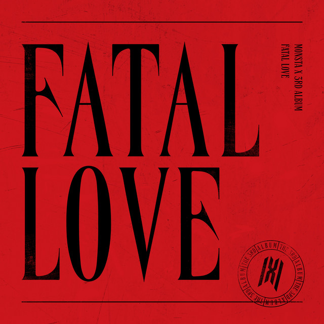

# Fatal Love

- 아티스트: 몬스타엑스
- 발매일: 2020-11-02
- 별점: ★★★★ 4.0
- 기록일: 2025-11-25
- repov 인덱스: 618

---

몬스타엑스 디스코그래피 사상 최고의 걸작

1. Love Killa 4.0
도입부의 스산한 바람소리부터 심상치 않다. 몬스타엑스가 총을 쏜다는 건 이제부터 진심을 다하겠다는 의미다. 당연히 뛰어나다. 기현의 존재는 보물이다.

2. 갈증 4.5
몬스타엑스가 처음 라틴을 시도한 게 Magnetic이었나? 그 때도 잘 어울린다 생각했는데, 이 노래는 가히 걸작이라 부를만 하다. 라틴은 섹시한 음악이고 몬스타엑스는 섹시한 그룹이다. 더 설명이 필요한가?

3. Thriller 3.5
단 한 순간도 쉬지 않고 밀어 붙이려면 멤버들 체급이 이 정도는 되어야 한다. 그래도 노래 자체가 무거운 건 어쩔 수 없다 생각이 들 때 쯤 셔누가 역할을 톡톡히 한다. 형원의 고음은 옥의 티다. 파트를 쪼개서 뒤는 셔누에게 넘겼어야 했다.

4. Guess Who 4.0
이 노래의 인스트루먼트를 강렬히 가지고 싶다. 물론 주헌과 아이엠, 기현의 더블링 트랙은 포함된 상태여야 한다. 당연하지. 음악을 이 수준으로 하면 그것까지 인스트루먼트라고 부르는 거다. 이토록 다크한 음악에서는 특히 셔누가 빛을 얻는다. 민혁은 콧소리가 과했다.

5. Nobody Else 3.5
이에 쩍쩍 달라 붙을 정도로 짙다. 형원의 영리한 점은 이런 노래에서 나타난다. 자신은 가장 잘할 수 있는 부분을 가져간 뒤, 남은 완성도를 멤버들에게 온전히 맡긴다. 그래도 된다. 그 정도로 신뢰할 수 있는 실력이니까.

6. BEASTMODE 5.0
일어나라. 이런 노래는 앉아서 감상하는게 아니다.

7. 대동단결 3.5
확실히 주헌은 빡센 노래를 할 때 탑라인에서 한계가 온다. 이게 주헌만 가지고 있는 문제는 아니다. 원래 이런 노래를 하다보면 대부분 멜로디를 놓친다. 그 에픽하이의 타블로도 Face ID의 싸비만은 못 살렸다. (그건 투컷 노래긴 하지만.) 아무래도 래퍼의 역량만으로 이미 벼랑 끝까지 밀어붙일 수 있으니까 그렇게 되는 듯.

8. Night View 4.0
U R에서 감을 잡은 아이엠이 완전히 날아오른 노래다. 노래에서 공감각이 느껴지게 만드는 건 정말 어려운 일이다. 습기 어린 선선한 밤이고, 우리는 고속도로 위에서 차를 달리고 있다. 밤하늘에 별은 반짝이고 가로등은 붉은 색이다. 창문 밖으로 손을 뻗으면 공기가 만져진다. 이보다 더 탁월한 드라이브 송이 있겠는가?

9. Last Carnival 3.5
도입부가 좀 과하게 무겁다. 이렇게까지는 안해도 됐는데. 다행히 그 뒤로는 무엇 하나 허투루 쓰인 사운드가 없다. 기현과 셔누를 이 정도만 써도 노래가 좋을 수 있다는 자신감이 느껴진다.

10. Sorry I'm Not Sorry 4.0
내 잘못인 이별이라면, 딱 이 정도의 온도가 좋겠다.
