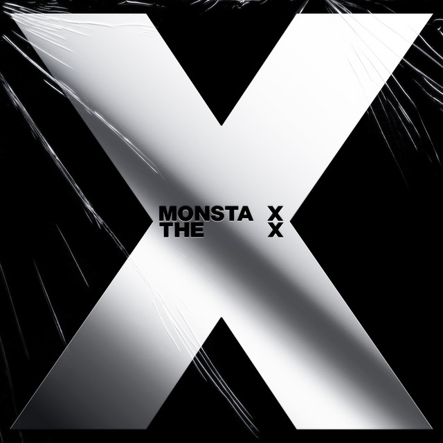

# THE X

- 아티스트: 몬스타엑스
- 발매일: 2025-09-01
- 별점: ★★★ 3.0
- 기록일: 2025-11-25
- repov 인덱스: 619

---

타이틀이 마음에 안 들었으면 송캠프라도 열고 작곡 멤버들끼리 대화 좀 해라 제발.

1. Do What I Want 3.5
적당하다. 주헌이 잘 깔아놓은 리듬 위로 셔누의 음색이 미끄러지고 기현의 애드립은 킥으로 들어간다. 형원도 저음이 매력적이다. 이걸 그냥 타이틀로 밀고 갔으면 적어도 나는 쌍욕 안 했다. 그런데 셔누한테 랩 좀 시키지 말라고. 그리고 아이엠 파트는 뭘 노렸는지 알겠으나 텐션을 과도하게 떨어뜨렸다. 노래 2분 40초 밖에 안되니까 힘 좀 넣어라.

2. N the Front 1.0
이걸 타이틀로 하자고 투표한 멤버들 지금이라도 반성하길 바란다. 진심인가? 셔누 기현의 목소리가 이런 거 하라고 있는 줄 아나? 주헌이랑 기현이 불러서 괜찮다고 괜찮은 노래라 착각 좀 하지 말라니까? 굴소스랑 치킨스톡 넣었는데 맛없으면 그게 기적이라니까?

3. Savior 3.5
이거 기현이 힘들어서 하지 말자고 한 거면 미안한데 다음부터 기현은 투표에서 빼라. (물론 그 양반이 그랬을 거라 생각하진 않는다.) 정말 솔직하게 말해서 몬스타엑스 노래는 기현이 개고생하는 정도에 완성도가 달려 있으니까. 아, 판타지아는 제외하고.

4. Tuscan Leather 3.5
랩을 이렇게 할 줄 안다면 올드힙합이 관짝에 들어가고 있는 트렌드 같은 건 아무 상관 없다. 주헌한테 하는 얘기다. 소스도 삐까번쩍 비싸구만 이런 노래를 아껴둬서 대체 뭐할 건데? 아 그런데 탑라인은 이제 다른 사람을 좀 시켜보는 게 어떤지.

5. Catch Me Now 3.5
이걸 민혁과 형원이 밀었다고 알고 있다. 확실히 둘이 듣는 귀가 세련됐다. 그런데도 물러선 건 이걸 타이틀로 들고 나왔을 때의 팬덤 민심을 감당하기 어려워서겠지? 도저히 빡센 퍼포먼스가 그려지지 않으니까. 그런데 그건 안무가가 걱정할 몫이잖아.

6. Fire & Ice 3.0
If with U가 슬쩍 생각난다. 몬스타엑스의 멤버 작곡곡은 어쩐지 기현을 어떻게 쓰느냐를 겨루는 시합 같이 되어버렸는데, 제일 한계까지 밀어붙이는 게 아이엠이고 바닥까지 싹싹 잘 긁어 쓰는게 주헌이라면 가장 영리하게 쓰는 건 형원이다. 그래서 기현이 형원의 곡을 부르길 좋아하는게 느껴진다. 그런데 이 노랜 양심적으로 곡비 30% 떼줘라. 기현 애드립 들으려고 듣는 노랜데.
