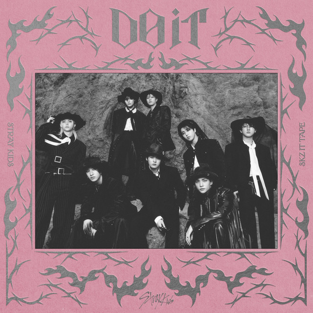

# DO IT

- 아티스트: Stray Kids
- 발매일: 2025-11-21
- 별점: ★★☆ 2.2
- 기록일: 2025-11-25
- repov 인덱스: 621

---

그래 군대 잘 갔다 오고

1. Do It 1.5
이쯤 되면 내가 좋은 음악을 찾는 건지 그냥 신선함을 찾는 건지도 헷갈린다. 확실한 건 힙합에 라틴 댄스는 그다지 신선하지 않다는 거다. 이미 방탄소년단이 한 거 아니냐는 생각이 계속 맴도는데, 아쉽게도 스트레이키즈에는 그 데자뷰를 지워버릴 압도적 피지컬이 없다. 리믹스는 차라리 웃기기라도 한다.

2. 신선놀음 2.0
팬덤에서는 왜 이걸 타이틀로 안했냐고 욕 좀 나올 거 같은데? 전형적인 스트레이키즈 음악이라고 하면 이쪽이 맞다. 슬슬 관짝 못 박고 있는 90년대 힙합을 뜬금없는 삐꾹 한 번에 살려낼 수 있다고 믿는 점에서. 트렌드를 의식한다면 훅이 있는 Do It 쪽이 안전하게 느껴졌을 거다. 나는 어떻냐고? 어차피 죽도 밥도 아닐 거면 하던 거 하라는 쪽이다. 하던 건 잘할 가능성이 높으니까. 그리고 메인보컬과 필릭스의 목소리로 시작하는 최소한의 치사함이라도 있잖아.

3. Holiday 2.5
뭘 하고 싶은 지는 알겠는데 스트레이키즈가 이런 거 잘하는 그룹은 아니다. 일단 소스 선택부터 틀렸다. 한이 좀 더 비전을 밀어붙였다면 이야기가 달라졌을 수 있는 노래다.

4. Photobook 2.5
전형적인 군대 가기 전 남자 아이돌 발라드송. 팬들이야 당연히 좋아하겠는데 나한테도 좋게 들려서 좀 놀랍다. JYP는 이제 댄스팝 보다 밴드 사운드를 더 잘 하는 거 같은데? 농담 아니다.
