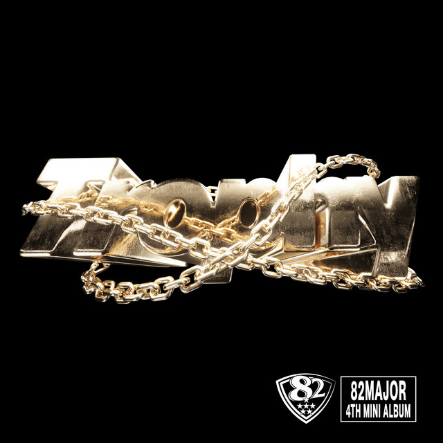

# 트로피 (TROPHY)

- 아티스트: 82MAJOR
- 수록: Trophy
- 별점: ★★★☆ 3.5
- 기록일: 2025-11-14
- repov 인덱스: 632

---

82메이저에게는 기대치가 있다. 가장 세련된 비트를 들고 오겠지. 뮤직비디오는 까리하겠지. 퍼포먼스는 멋있겠지.

이렇게 높은 기대치를 만들고 달성하는데 기획만 기여했다고 말하는 건 정당하지 않다. 오해는 하지 말길. 82메이저의 존재감에는 여전히 프로덕션이 큰 크레딧을 차지한다. 대구힙합페스티벌과 맥퀸 패션쇼를 자연스럽게 오가는 IOAH는 존재 자체로 성수동 힙합을 증명한다. 미니멀하지만 그만큼 여유로운 안무는 패셔너블한 비트와 합쳐져 길쭉길쭉 시원하다. 거기에 와일드하지만 추레하지 않은 스타일링까지. 과연 그레이트엠은 2025년 현존하는 소속사 중에 가장 밥상을 잘 차려준다고 해도 과언이 아니다.

그런데 밥상 잘 차려줘도 멤버들이 받아먹지 못하면 소용이 없는 것이다. 그거 떠먹는 게 직업인 사람들인데 당연한 거 아니냐고 하겠지만, 사실 케이팝 좀 해본 사람들은 안다. 아니, 어쩌면 사회생활 하는 사람들 전부 공감할지도. 세상에는 제가 해야할 일 못하는 사람이 너무 많다는 걸. 흰 쌀밥 위에 금태 가시 싹싹 발라 금수저 위에 얹어줘도 떠먹지를 못해 고꾸라지는 임원분들이 차고 넘친다. 이제 고작 10대 20대인 아이돌은 오죽하겠나?

82메이저는 주어지는 것을 이해하고 즐길 줄 안다는 점에서 괜찮은 그룹이다. 이런 거 좋아하는 남자애들 모아 놓고 이런 거 하게 만들어 줬으니, 작두를 타는 건 이제 멤버들의 몫이다. 82메이저 멤버들은 늘 그 마지막 킥을 잘 수행해왔다.

서론이 길었는데, 이 노래는 바로 그 부분에서 아쉽다. 82메이저는 좋아하는 거 하는 놈들이 얼마나 잘하는지 보여주기 위해 존재하는 그룹인데, 아쉽게도 이번 활동의 이해도나 열의는 이전같지 않다. 이 좋은 비트에도 명작의 반열로 쉽게 발돋움하지 못하는 건 그 때문이다. 프로듀서나 소속사가 억울해할 일은 아니다. 원래 작품의 완성도는 결말이 결정하는 법이니까. 다만 멤버들은 좀 더 기운을 내야겠지.

그래도 다행히 리더가 파이팅이 있다. 막내도 여전히 당차고. 82메이저가 순조로운 상승세를 유지하려면 두 사람의 역할이 중요하다. 부디 주저앉지 말길. 해결할 건 해결 좀 하고.
