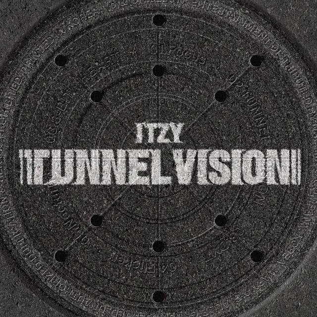

# TUNNEL VISION

- 아티스트: ITZY
- 발매일: 2025-11-10
- 별점: ★★★☆ 3.4
- 기록일: 2025-11-13
- repov 인덱스: 633

---

뛰어난 기획 의도를 가지고 출발한다. 처음은 조금 삐끗하기 마련이다. 그래도 터널 하면 역시 롤러코스터 아니겠어?

1. Focus: 3.0
있지의 넥스트 챕터 롤러코스터, 조금 늦었지만 지금부터 운행 시작합니다.

2. TUNNEL VISION: 2.5
있지가 데려다주는 할로윈은 꽤 재밌... 을 뻔 했다. 3분 내내 집중을 하고 긴장감을 가져갔다면 그럴 수 있을 노래였다. 멜로디는 적당할 정도로만 흥미로웠고, 비트는 딱 1분 55초까지만 들을만하다. 그 뒤로 이어지는 내용은 어떻게 들어도 꾸역꾸역 시간 채우기에 가깝다. 앨범의 얼굴이 되는 타이틀은 이렇게 대충 만들지 말아야 한다. 조금만 더 정성을 쏟았다면 이보다 세 계단은 좋을 수 있는 노래였다.
+ ) 그리고 이건 Dem Jointz에게 개인적으로 가지고 있는 불만인데, "Incoming~" 하는 이 시그니처 사운드 별로다. 어떤 노래에서도 좋았던 적이 없다.
+ ) 라이언 전은 이제 단물도 안 나온다. 그만 씹고 싶으니까 제발 그만 좀 써라.

3. DYT: 3.0
켄지다. 알겠다. 정말 처음부터 끝까지 알겠다. 그런데 이 양반은 알겠는데도 하품이 안 나온다. 그것도 참 대단한 재주다. 특출나진 않지만 졸작은 아니다. 어쩌면 있지에겐 이게 제일 안 좋은 걸수도.

4. Flicker: 3.5
의도에 정확히 들어맞은 장르. UK개러지로 분류되어 있는데, 사실 정확히 말하면 케이팝에서 몇 번 변주한 팝 하우스와 UK개러지의 과도기에 존재한다. (물론 하우스와 UK개러지의 경계는 무 자르듯 잘리지 않고 개러지 하우스의 경우 아예 같은 장르로 보기도 한다.) 여튼 근 3년간 그렇게 쏟아졌음에도 여전히 상쾌한 걸 보면 이런 Chill한 EDM이 케이팝 내에서 꽤 오랜 시간 생명력을 가지고 있을 것 같다.
보컬과 랩의 톤을 자제한 것은 탁월한 선택. 좀 더 과열됐으면 영락없이 아이즈원의 파노라마가 떠올랐을 텐데, 있지는 그보다는 성숙한 이미지의 그룹이니까.
여러 가지로 생각했을 때 나무랄 구석이 전혀 없다. 다만 이 노래가 타이틀이어야 했다고는 생각하지 않는다.

5. Nocturne: 4.5
그렇지. 정확히 이런 채도와 무게를 원했다. R&B를 서늘하게 표현할 수 있는 건 있지의 목소리가 가진 재능이다. 꿈이라 하기엔 스산하고, 악몽이라 하기엔 아름다운 판타지가 유령마냥 스쳐지나간다. 모두의 목소리가 제자리에서 촛불 같은 빛을 내고 있다. 마지막에 잠깐 등장하는 하모니는 환상처럼 귀를 사로잡는다.
모모랜드, 아이돌학교 출신의 C'SA가 작곡에 참여한 것이 눈에 띈다. 젊은 여자 프로듀서들의 약진이 반갑다.

6. 8-BIT HEART: 4.0
JYP는 타이틀을 좀 보수적으로 정하는 경향이 있다. 대중을 상대로 게임을 걸지 않는다. 소속사 사장부터가 대중성의 악마 같은 사람이긴 한데, 가끔은 그 보수성이 굉장히 지겹다. 서론이 길었는데 나라면 이 노래를 타이틀로 생각했을 거란 얘기다. 고딕 양식의 롤러코스터가 데려다 준 세계가 총천연 네온색의 디지털 세계라니. 어쩌면 이 당돌함이야말로 데뷔 때부터 가지고 있던 진정한 있지의 정신 아닌가?
