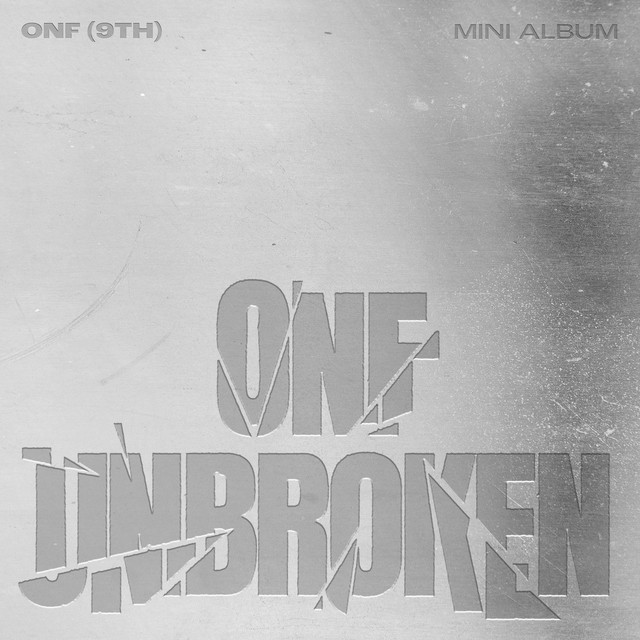

# UNBROKEN

- 아티스트: 온앤오프
- 발매일: 2025-11-10
- 별점: ★★☆ 2.9
- 기록일: 2025-11-11
- repov 인덱스: 634

---

앨범 제목에 걸맞지 않게 평범한 포부가 아쉽다. 온앤오프는 여기서 안주해도 되는 그룹이 아니다.

1. Put It Back: 2.0
The Stranger에서 패기가 빠진 아류작. 이것이 타이틀이어야 하는 이유는 없고, 이걸 온앤오프가 해야할 이유는 더더욱 없다.

2. Broken Map: 3.0
도입부가 제일 좋고 뒤로 갈수록 텐션이 떨어지는 것이 아쉽다. 달콤한 인트로 뒤 묵직한 힙합 베이스 위에 서늘한 멜로디를 얹는 1절까지의 구성은 익숙하지만 시도할 때마다 좋은 밸런스를 들려준다. 브릿지의 반전을 앞으로 당겨 2절에서 시도했다면 훨씬 재밌게 들을 수 있었을 테다. 효진의 보컬은 겉도는 감이 있다.

3. Moonlight Festa: 3.5
왜 좋은 노래를 타이틀로 하지 않는 걸까? 온앤오프의 존재가 케이팝에서 어떤 역할을 하는지 설명해주는 곡이다. 밤하늘 별이 반짝이는 듯한 신스 위에 판타지를 얹었다. 보컬은 일부러 자제한 것 같은데 나는 시원한 쪽이 더 취향.

4. New Dawn: 3.0
아이돌 앨범의 발라드 트랙은 대부분 좋게 말해 편안하고 나쁘게 말하면 진부하다. 다행히 이 노래는 좋게 말해줄 수 있을 정도가 된다.

5. I Found You In Heaven: 3.0
일단 기타가 재밌다. 밴드 사운드를 들고 나오려면 가져야 하는 최소한의 미덕은 갖춘 셈이다. 하지만 "좋다" 이상을 이끌어내려면 더 강한 포부를 갖춰야 한다.
