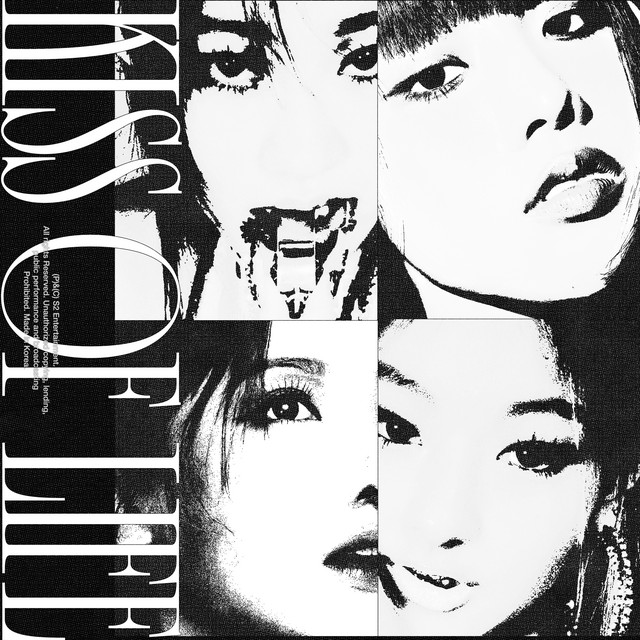

# Born to be XX

- 아티스트: KISS OF LIFE
- 발매일: 2023-11-08
- 별점: ★★★★★ 5.0
- 기록일: 2025-10-31
- repov 인덱스: 638

---

키스오브라이프가 괴물이라 불린 이유

1. Bad News 5.0
모름지기 크게 될 그룹에는 이런 노래가 하나씩 있어줘야 하는 법이다. 모든 멤버가 처음부터 끝까지 작정하고 펀치를 날린다. 쥴리의 랩과 벨의 휘슬노트를 들으며 자리에서 일어나지 않는다면 당신은 음악과 함께 갈 수 있는 사람이 아니다.

2. Nobody Knows 5.0
키스오브라이프의 정체성이 무엇일까. 모든 노래가 후보가 될 자격이 있지만, 나는 개인적으로 이 노래라고 생각한다. 이 당시 여자를 좋아할 수 있는 모든 사람이 키오프를 욕망했다.

3. My 808 5.0
중력 훈련 같은 노래다. 아니면 느리게 밟아나가는 롤러코스터를 탔거나. 묵직하게 몸을 내리누르듯 솟구치다가, 다음 순간 자유낙하하듯 몸이 간지러워진다.

4. TTG 5.0
전남친 욕하고 저주하고 죽어라 뒷담까는 노래가 케이팝에 더 필요하냐고? 아니 그럼 지금까지 케이팝이 뭐라고 생각했던 건가? 여기는 원래 원한과 살풀이의 장이다. 타이틀과 대조를 이루는 게 분명한, "Good News가 들려"라는 가사가 킥이다.

5. Gentleman 5.0
아프로비트와 레게 리듬 위로 전혀 젠틀하지 않은 808 베이스가 빈둥거린다. 당연하지만, 이게 젠틀맨 필요하다는 노래겠어? 점잖은 척 그만 떨고 와서 누우란 뜻이지.

6. Says It 5.0
훌륭한 팬송에는 몇 가지 조건이 있다. 멤버가 만들 것, 실력이 좋을 것, 진심으로 노래할 것. 그러니 이 노래는 이미 만점으로 시작한 셈이다.

7. Bad News (Eng ver.) 5.0
보통 한 앨범에 들어 있는 다른 언어 버전은 아예 점수를 매기지 않는데, 이 노래는 따로 점수를 매겨야하고 그것도 만점을 줘야 한다. 영어를 잘해서가 아니다. 두 명은 원어민이고 하늘은 영어를 못하는데 그런 걸 칭찬할 생각은 없다. 다만 이 노래의 편곡이 훨씬 공격적이며, 그에 따라 모두의 목소리가 훨씬 공격적으로 담겼다. 의도가 있고 그 의도가 납득할만하며 정확히 수행한 곡은 찬사를 받아 마땅하다.
