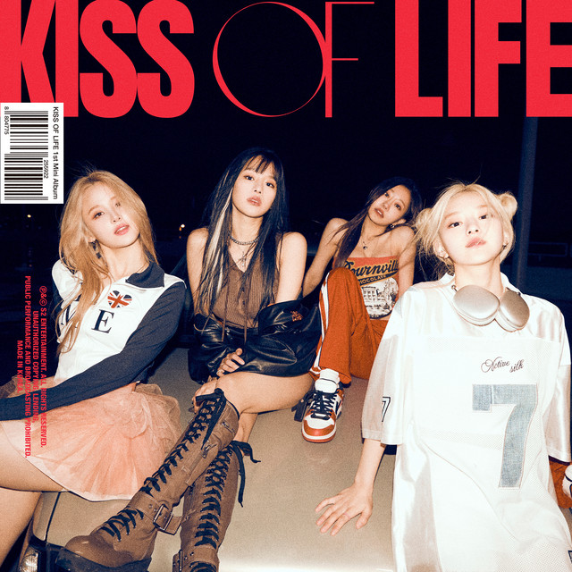

# KISS OF LIFE

- 아티스트: KISS OF LIFE
- 발매일: 2023-07-05
- 별점: ★★★★★ 5.0
- 기록일: 2025-10-31
- repov 인덱스: 639

---

그토록 바랐던 세상으로 뛰어들자. 그만큼 빛나는 꿈이니까.

1. 쉿(Shhh) 5.0
처음 들었을 때는 멤버들 능력치를 제외하고 그 당시 나온 노래들보다 그다지 특출나진 않다 생각했는데... 그냥 2023년이 케이팝의 황금기였던 것이다. 뉴진스와 데이식스와 82메이저의 아류작으로 점철된 지금 들으니 선녀가 따로 없다.

2. 안녕, 네버랜드 5.0
당신의 심장을 울릴 가사는 "벽장 속이 든 상처, 먼지 쌓인 밤"일까 아니면 "내 벽지 위로 변치 않던 아픔의 키를 재"일까?

3. Sugarcoat 5.0
온 세상이 나띠를 사랑할 수밖에 없었을 테다. "짜릿한 해방감 속 만나게 될 모든 날, 사랑할 수밖에 없을 테니".

4. Countdown 5.0
처음 듣고서는 드디어 테디의 자리를 차지할 탑라이너가 생겼다며 기뻐했다. 크레딧을 보기 전이었는데, 알고 보니 자작곡이더라고. 벨은 훨씬 더 적극적으로 키오프 앨범에 참여할 필요가 있다.

5. Kitty Cat 5.0
그동안 케이팝 걸그룹이 들려준 모든 전설적인 랩 라인을 모아 팝적으로 해석한 곡. 개인적으로 안타까운 게 있다면, 내가 봤을 때 키씨 중 대다수가 이 노래의 뮤비를 안 봤다. 키스오브라이프는 맏언니가 R-18 뮤직비디오로 데뷔한 그룹입니다.

6. Play Love Games 5.0
노래만 들었을 때도 하늘이 마냥 귀여운 막내일 거라 생각하지 않았다. 심지어 힌트도 잔뜩 줬으니, 이제와 배신감에 몸을 떨지 마라. 분명히 얘기하지 않나? "날 다 안다고 착각 말기".
